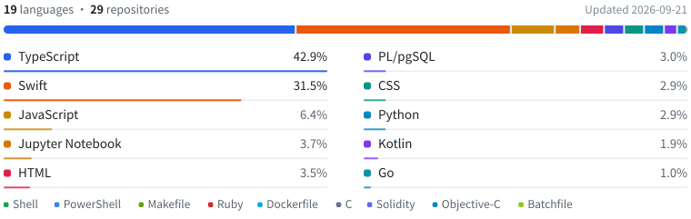

PolyU freshman · Co-founder · Photographer · Bass player Learning product, design, and agent engineering — building apps and tools across Apple platforms and the web. Favorite show: <em>Severance</em> · Favorite band: <em>my little airport</em> Say hi anytime — always down to chat or build together.

  <a href="https://open.spotify.com/user/31mix2lsown7l4ycqak56qbeq6yy"> Spotify ↗</a> &nbsp;·&nbsp;
  <a href="https://www.linkedin.com/in/siyi-lyu-b496a93b9/"> LinkedIn ↗</a> &nbsp;·&nbsp;
  <a href="https://x.com/4Fe119a"> X ↗</a>

  <a href="#stack">Stack</a> &nbsp;/&nbsp;
  <a href="#stats">Stats</a> &nbsp;/&nbsp;
  <a href="./README.zh-CN.md">简体中文</a>

## Stack

**Languages** &nbsp;  Swift ·  Kotlin ·  Python ·  TypeScript **Apps & Web** &nbsp; SwiftUI · React · Next.js · Supabase **AI & Vision** &nbsp; MLX · PyTorch · OpenCV · MCP

## Stats

<picture>
  <source media="(max-width: 600px) and (prefers-color-scheme: dark)" srcset="./assets/contribution-languages-v3-inline-mobile-dark.svg" />
  <source media="(max-width: 600px)" srcset="./assets/contribution-languages-v3-inline-mobile-light.svg" />
  <source media="(prefers-color-scheme: dark)" srcset="./assets/contribution-languages-v3-inline-dark.svg" />
  
</picture>

Repositories with my commits · public + authorized private · repository-normalized language mix.

Data & methodology

Counts public and authorized private repositories with commits attributed to **zs-andy** (from GitHub contribution history and accessible branches, excluding third-party clones). Each repository with GitHub Linguist data is weighted equally to average language proportions—reflecting repository composition rather than personal lines of code. Only aggregate totals and repository counts are published.

[Full methodology](./docs/profile-stats.md) · [Data](./assets/language-data.json) · [Generator](./scripts/update-language-card.mjs) · [Workflow](https://github.com/zs-andy/zs-andy/actions/workflows/update-language-card.yml)

  <a href="https://github.com/zs-andy?tab=repositories">All repositories ↗</a>

