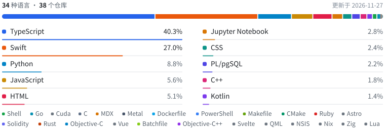

PolyU 大一 · 联合创始人 · 摄影 · 贝斯手 在学产品、设计与 Agent 工程，边做 Apple 平台和 Web 上的应用与工具。 最喜欢的剧是《人生切割术》，最喜欢的乐队是 <em>my little airport</em>。 欢迎随时找我玩，也欢迎一起折腾点有意思的东西。

  <a href="https://open.spotify.com/user/31mix2lsown7l4ycqak56qbeq6yy"> Spotify ↗</a> &nbsp;·&nbsp;
  <a href="https://www.linkedin.com/in/siyi-lyu-b496a93b9/"> LinkedIn ↗</a> &nbsp;·&nbsp;
  <a href="https://x.com/4Fe119a"> X ↗</a>

  <a href="#技术栈">技术栈</a> &nbsp;/&nbsp;
  <a href="#统计">统计</a> &nbsp;/&nbsp;
  <a href="./README.md">English</a>

## 技术栈

**编程语言** &nbsp;  Swift ·  Kotlin ·  Python ·  TypeScript **应用与 Web** &nbsp; SwiftUI · React · Next.js · Supabase **AI 与视觉** &nbsp; MLX · PyTorch · OpenCV · MCP

## 统计

<picture>
  <source media="(max-width: 600px) and (prefers-color-scheme: dark)" srcset="./assets/contribution-languages-v3-inline-zh-CN-mobile-dark.svg" />
  <source media="(max-width: 600px)" srcset="./assets/contribution-languages-v3-inline-zh-CN-mobile-light.svg" />
  <source media="(prefers-color-scheme: dark)" srcset="./assets/contribution-languages-v3-inline-zh-CN-dark.svg" />
  
</picture>

包含本人提交的仓库 · 公开＋获授权的私有仓库 · 按仓库归一化的语言分布。

数据与统计方法

统计包含归属于 **zs-andy** 提交的公开及获授权私有仓库（基于 GitHub 贡献记录与可访问分支校验，排除第三方复制仓库）。各仓库先按 GitHub Linguist 计算语言占比，再等权取平均，反映仓库语言结构而非个人代码行数。仅公开汇总数据与仓库总数，不泄露具体仓库或提交信息。

[完整说明](./docs/profile-stats.md) · [数据](./assets/language-data.json) · [生成脚本](./scripts/update-language-card.mjs) · [更新状态](https://github.com/zs-andy/zs-andy/actions/workflows/update-language-card.yml)

  <a href="https://github.com/zs-andy?tab=repositories">全部仓库 ↗</a>

